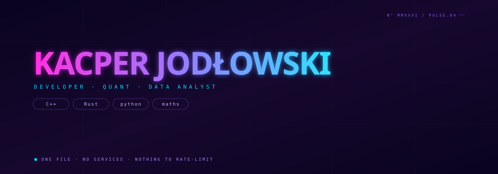

  

### whoami

I'm a Mathematics MSc student at the University of Wrocław,
interested in the intersection of mathematical reasoning and
practical software development.

I enjoy understanding how things work — from algorithms and
statistical models to database systems and software architecture.
### currently

- **Software Engineering** — designing and building maintainable applications
- **Mathematics & Algorithms** — turning abstract ideas into working solutions
- **Data & Quantitative Analysis** — modelling, simulation and statistical reasoning
- 
— [{{website}}]({{website_url}}) · [@{{twitter}}](https://twitter.com/{{twitter}})

---

## About me

I'm a Mathematics MSc student at the University of Wrocław,
interested in the intersection of mathematical reasoning and
practical software development.

I enjoy understanding how things work — from algorithms and
statistical models to database systems and software architecture.

Currently exploring:
- **Software Engineering** — designing and building maintainable applications
- **Mathematics & Algorithms** — turning abstract ideas into working solutions
- **Data & Quantitative Analysis** — modelling, simulation and statistical reasoning

## Featured projects

| Project | What it demonstrates |
|---|---|
| [Food Manager](https://github.com/kacper-jod/Gulbee---Food-Manager) | Application development and software architecture |
| [Shopping App](https://github.com/kacper-jod/Shopping-App) | Database design, SQL and data-driven applications |
| [Sudoku Solver](https://github.com/kacper-jod/sudokuSolver) | Algorithms and problem-solving |
| [Project AI](https://github.com/kacper-jod/Project_AI) | AI / machine learning exploration |

## Tech stack

  

## A mathematical mindset

  <i>“The art of doing mathematics is finding that special case
  that contains all the germs of generality.”</i>
   
  — David Hilbert

---

  <i>Always learning. Always building.</i>

